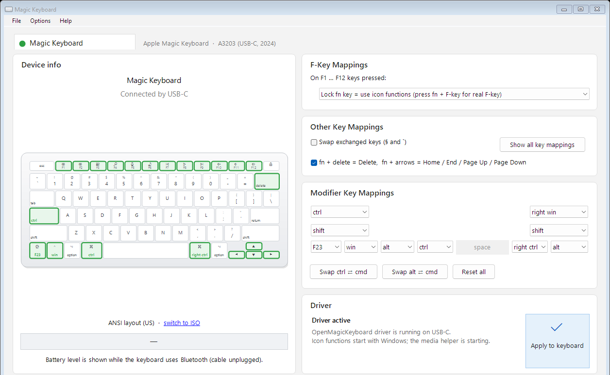

# OpenMagicKeyboard

Windows 11 x64 driver and app for the **Apple Magic Keyboard A3203** (USB-C, 2024,
no Touch ID — USB `VID_05AC&PID_0320`, Bluetooth `VID&0001004C_PID&0320`).
Works over **Bluetooth and USB-C** with one shared profile. Original MIT-licensed code.

**Current version: 0.4.0.0.** Build output goes to `artifacts\Release` (not committed; see *Build from source*).



What you get:

- fn / Globe key (sent to Windows as F23), fn + delete = forward Delete, fn + arrows = Home / End / Page Up / Page Down
- F1–F12 as media / brightness keys (or standard F-keys, or locked fn)
- Remap Control, Option, Command, Caps Lock and Shift (e.g. Ctrl ⇄ Cmd)
- ISO § / ` key swap, battery level (Bluetooth)

## Install

Requirements: Secure Boot **off** and Windows **test signing** on, because the driver is
signed with a local test certificate, not by Microsoft. Windows then shows a "Test Mode"
watermark. Build and sign the package first (see *Build from source*).

1. Open the app: `artifacts\Release\MagicKeyboardGui.exe`
2. Click **Install driver** (or run `scripts\setup.ps1` in PowerShell) and approve the
   Windows prompt.
3. If test signing was off, setup turns it on and asks you to **restart Windows**.
   After the restart click **Install driver** again.
4. Setup binds the driver to the keyboard on every connection (USB-C and Bluetooth),
   verifies it loaded, removes any older project versions, and registers a recovery task.

Then pick your mappings in the app and click **Apply to keyboard** (also File → Apply, Ctrl+Enter).
**Options → Start with Windows** and **Options → Start minimized at sign-in** keep the app in the
notification area; click its tray icon to open it. Minimizing the window also sends it to the tray. The keyboard
reconnects for a moment. With an icon F-key mode, the small media helper starts
automatically with Windows.

Command-line equivalents (they relaunch elevated):

```powershell
.\scripts\setup.ps1 -Action Status       # what is installed and loaded (read-only)
.\scripts\setup.ps1 -EnableTestSigning   # install / repair
.\scripts\setup.ps1 -Action Uninstall    # back to the Microsoft driver (-RestoreVendor: Magic Utilities)
```

## Safety net

If the driver ever cannot load — for example because test signing was switched off
by an update — a keyboard with a broken lower filter would stop typing. The
`OpenMagicKeyboard Recovery` scheduled task checks at every boot and switches only
the affected Apple keyboard back to the Microsoft driver. Run setup again to reinstall.

## Troubleshooting

| App says | Do this |
| --- | --- |
| Driver blocked by Windows | Test signing is off. Click **Repair driver**, restart, click it again. |
| Using the Magic Utilities driver | Click **Install driver**. Magic Utilities stays installed; `-RestoreVendor` switches back. |
| Driver not installed | Click **Install driver**. |
| Keyboard not connected | Pair over Bluetooth or use a USB-C *data* cable. |
| Bluetooth won't reconnect after charging with the cable | Known Magic Keyboard behavior on Windows: cabling changes its Bluetooth pairing key. Remove "Magic Keyboard" in Settings → Bluetooth & devices and pair again; the driver attaches automatically. |

Setup logs are saved under `observations\setup-*`.

## Build from source

Needs Visual Studio with Desktop C++ and the WDK (installed on this PC).

```powershell
.\scripts\build.ps1 -Target Driver -Analyze          # driver package -> artifacts\Release\package
.\scripts\new-test-certificate.ps1 -Execute          # once per PC, elevated; prints a thumbprint
.\scripts\sign-package.ps1 -Thumbprint <thumbprint> -Execute
.\scripts\build.ps1 -Target DeviceBinding -Analyze
.\scripts\build.ps1 -Target Gui
.\scripts\build.ps1 -Target DriverTests -Analyze; .\scripts\test-driver.ps1   # host fuzz tests
.\scripts\test-gui.ps1; .\scripts\test-gui-layout.ps1
```

Test certificates expire (12 months by default); when yours does, create a new one and re-sign.

## Layout

| Path | Contents |
| --- | --- |
| `driver/` | KMDF lower filter (USB MI_01 + Bluetooth HID), descriptor parser and remapper |
| `tools/Gui/` | The app (WinForms, .NET Framework 4.8) and media helper |
| `tools/DeviceBinding/` | Binds a specific driver to one exact keyboard devnode |
| `tools/HidProbe/`, `tools/DriverTests/` | Metadata probe and host tests |
| `scripts/` | Build, sign, setup, tests |
| `docs/` | Background notes from development (protocol findings, Bluetooth details) |

## Version history

- **0.4.0.0** — fixed the driver failing to load: older packages were left staged and
  Windows later picked one whose service file had been deleted (Problem 39 /
  `0xC000003A`). Setup now keeps exactly one package. Control channel no longer stops
  working when USB-C and Bluetooth are both present; one profile applies to both;
  fn works without the three-tap check; new app UI with battery level; one-step setup
  and boot-time recovery.
- 0.3.0.1 — Bluetooth path and native brightness keys. 0.2 — fn combinations and icon
  modes. 0.1 — first USB filter.
